# ShopSense AI Frontend Architecture

Maintained in this independent Git repository at **docs/architecture.md**. Updated **2026-11-09**. The guide covers the implemented stack, interfaces, data model, operational limits, and release requirements.

## Contents

1. [Scope, users, and repository boundary](#1-scope-users-and-repository-boundary)
2. [Context, containers, and trust boundaries](#2-context-containers-and-trust-boundaries)
3. [Source ownership and module map](#3-source-ownership-and-module-map)
4. [Screens, navigation, and lifecycle](#4-screens-navigation-and-lifecycle)
5. [Primary workflows and recovery](#5-primary-workflows-and-recovery)
6. [Domain, persistence, and data ownership](#6-domain-persistence-and-data-ownership)
7. [API and internal contracts](#7-api-and-internal-contracts)
8. [Security, privacy, and egress](#8-security-privacy-and-egress)
9. [Design, accessibility, and platform adapters](#9-design-accessibility-and-platform-adapters)
10. [Build, checks, and deployment](#10-build-checks-and-deployment)
11. [Architecture decisions and tradeoffs](#11-architecture-decisions-and-tradeoffs)
12. [Requirements traceability](#12-requirements-traceability)
13. [Dated verification and limitations](#13-dated-verification-and-limitations)
14. [Extension rules and companion repository](#14-extension-rules-and-companion-repository)

## 1. Scope, users, and repository boundary

Catalog-grounded product discovery and comparison for shoppers.

Deterministic catalog matching, explanations, comparisons, browser-local saved IDs/theme, query sessions, and feedback. No external LLM is connected.

This repository owns the Next.js/React web interface, public content, interaction state, and API adapter. The API owns authoritative domain records and permission decisions.

There are two independent Git roots for this application, each with its own README and architecture guide. A parent app/workspace folder is a checkout convenience. Use synthetic records; current local services remain on loopback.

### Product Boundary

ShopSense AI supports catalog discovery and comparison for shoppers. Its local ranker is deterministic and only returns product data and matched attributes that exist in the catalog. There is no external recommendation provider, sign-in, or catalog-editor write endpoint in the current local implementation.

## 2. Context, containers, and trust boundaries

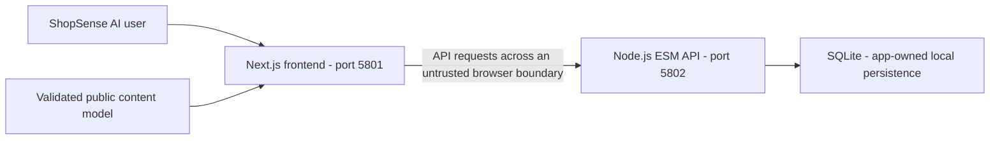

The browser must not grant roles or confirm prices, balances, payments, stock, or workflow completion based only on local state.

### C4 Context

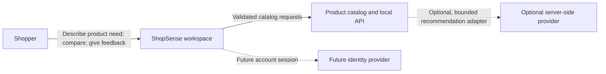

### C4 Containers and Current Data Flow

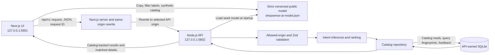

Trust boundaries: browser-to-Next.js (same-origin requests), Next.js-to-API (loopback rewrite), and API-to-database (only the API opens SQLite). The API validates the forwarded origin, schemas, and bounded request bodies. CORS is not authorization. The future provider boundary is server-only and disabled locally.

## 3. Source ownership and module map

| Owner/path                                                                                                                                                                                                                            | Responsibility                                                     |
| ------------------------------------------------------------------------------------------------------------------------------------------------------------------------------------------------------------------------------------- | ------------------------------------------------------------------ |
| [src/app/layout.tsx](../src/app/layout.tsx)<br>[src/app/page.tsx](../src/app/page.tsx)                                                                                                                                                | Web entry and composition                                          |
| [src/lib/api.ts](../src/lib/api.ts)                                                                                                                                                                                                   | API transport and response boundary                                |
| [src/config.ts](../src/config.ts)                                                                                                                                                                                                     | Build-time API mode selection                                      |
| [src/lib/model.ts](../src/lib/model.ts)                                                                                                                                                                                               | Content loading/provider contract                                  |
| [src/components/ComparisonDialog.tsx](../src/components/ComparisonDialog.tsx)<br>[src/components/ShopperApp.tsx](../src/components/ShopperApp.tsx)<br>[src/components/ShopperWorkspace.tsx](../src/components/ShopperWorkspace.tsx)   | Screens, composition, and interaction owners; see screen inventory |
| [src/hooks/useShopperBootstrap.ts](../src/hooks/useShopperBootstrap.ts)<br>[src/hooks/useShopperCatalogRetry.ts](../src/hooks/useShopperCatalogRetry.ts)<br>[src/hooks/useShopperComparison.ts](../src/hooks/useShopperComparison.ts) | Client hooks, presentation state, and domain adapters              |
| [src/app/globals.css](../src/app/globals.css)<br>[src/app/styles/responsive.css](../src/app/styles/responsive.css)                                                                                                                    | Authored styling and adaptation rules                              |
| [public/shopsense-ai-model.json](../public/shopsense-ai-model.json)                                                                                                                                                                   | Active public content/locale contract; no private credentials      |
| [tests](../tests)                                                                                                                                                                                                                     | Existing test/support directory; configured does not mean rerun    |
| [e2e](../e2e)                                                                                                                                                                                                                         | Existing test/support directory; configured does not mean rerun    |
| [.github/workflows](../.github/workflows)                                                                                                                                                                                             | Configured CI; hosted outcomes require separate verification       |
| [src/app/layout.test.tsx](../src/app/layout.test.tsx)<br>[src/components/ShopperApp.interactions.test.tsx](../src/components/ShopperApp.interactions.test.tsx)                                                                        | Examples of existing colocated tests                               |

The source map follows the existing framework directories and test placement.

## 4. Screens, navigation, and lifecycle

UI entry and interaction owners:

- [src/components/ComparisonDialog.tsx](../src/components/ComparisonDialog.tsx)
- [src/components/ShopperApp.tsx](../src/components/ShopperApp.tsx)
- [src/components/ShopperFrame.tsx](../src/components/ShopperFrame.tsx)
- [src/components/ShopperShell.tsx](../src/components/ShopperShell.tsx)
- [src/components/ShopperWorkspace.tsx](../src/components/ShopperWorkspace.tsx)

The active model is [public/shopsense-ai-model.json](../public/shopsense-ai-model.json). Preserve existing loading, empty, validation, permission, success, and failure states; model text does not provide server identity. Next App Router layout/page files own page composition; dialogs and selected views stay in the existing client components. Follow the authored source for request cancellation, retry, focus cleanup, and local preference behavior; do not infer an offline queue where none exists.

## 5. Primary workflows and recovery

### Ten User Flows

The browser is not authenticated. Product state is catalog-owned; saved IDs and
appearance are browser-local; search fingerprints and feedback are API-owned.

#### 1. Open discovery

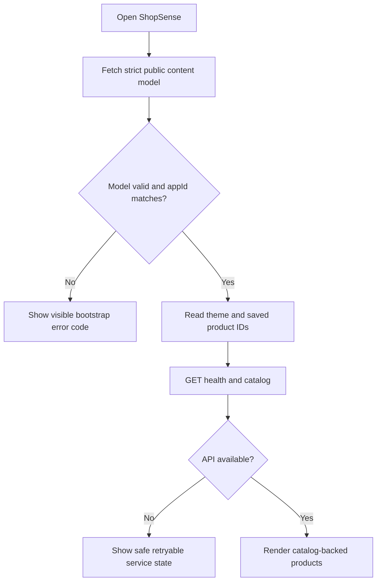

#### 2. Submit a product need

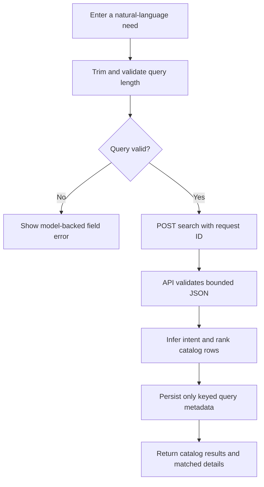

#### 3. Infer catalog intent

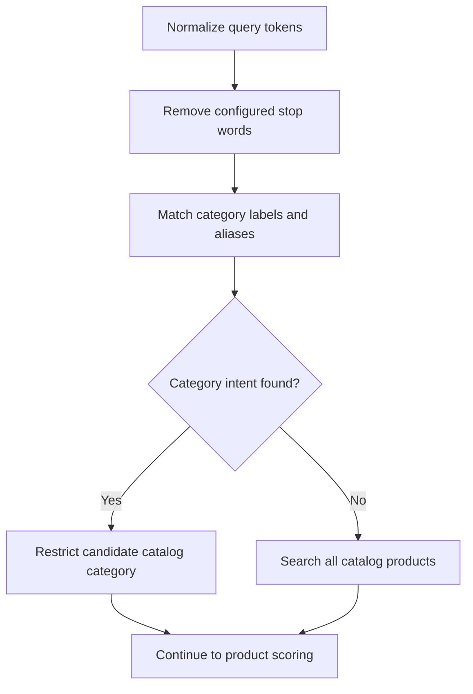

#### 4. Retrieve catalog items

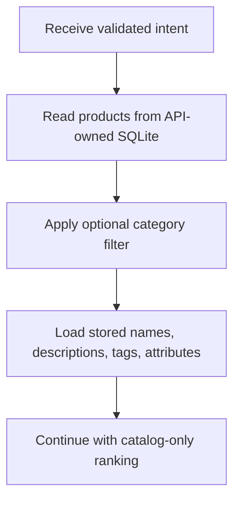

#### 5. Rank grounded matches

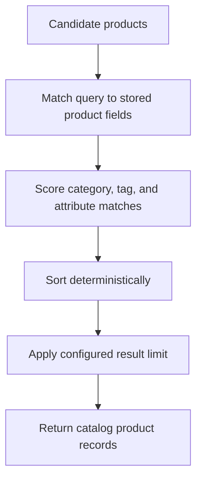

#### 6. Explain a match

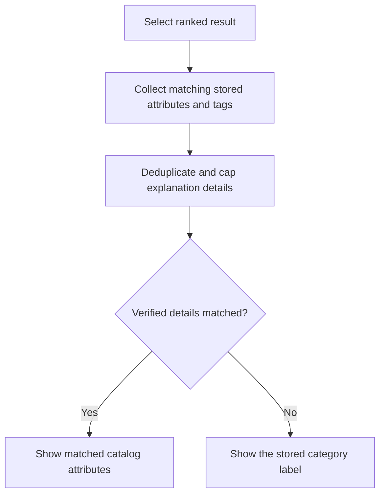

#### 7. Compare products

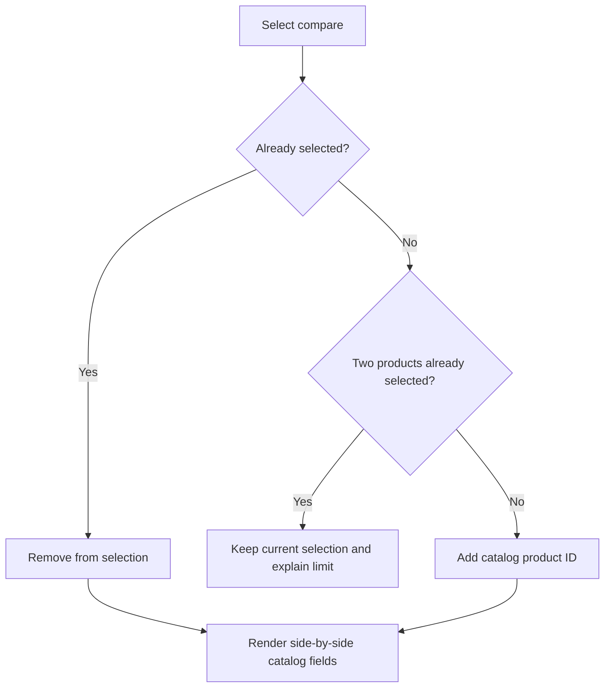

#### 8. Save a product

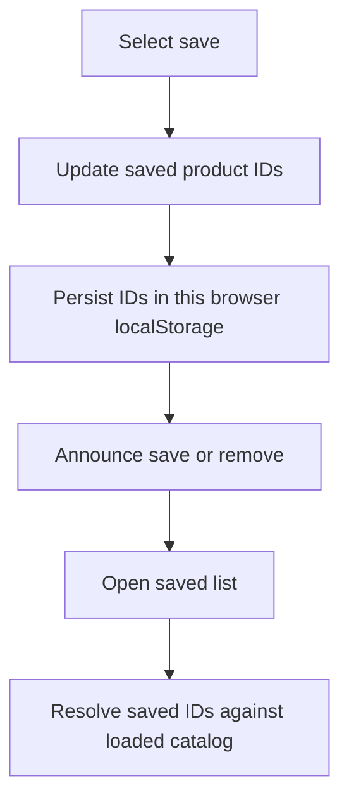

#### 9. Send feedback

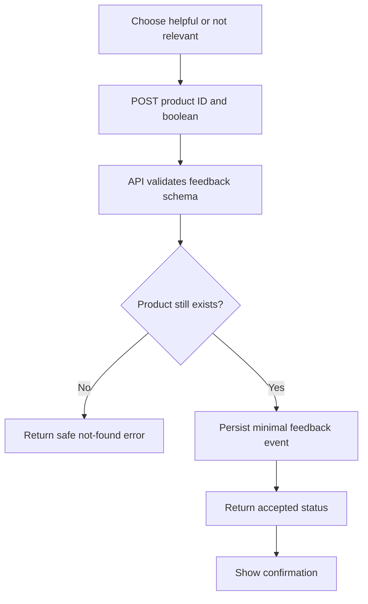

#### 10. Recover from no match or API failure

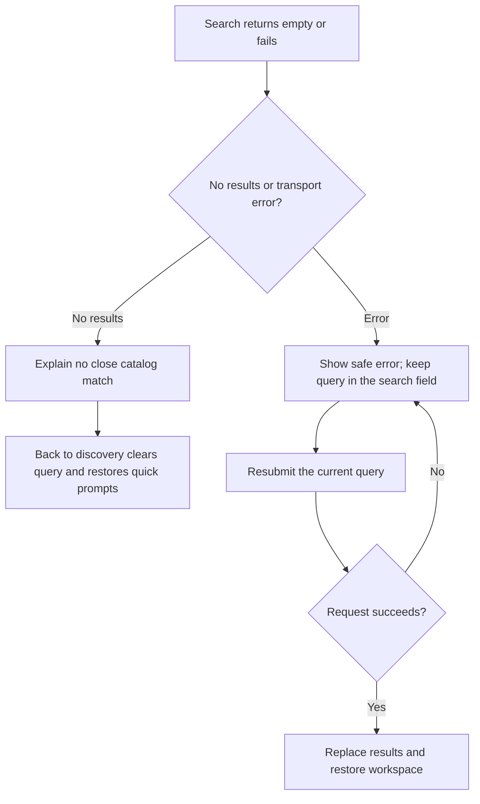

### Use-Case Preconditions, State, and Recovery

These are the implemented local workflows; planned identity, editor, and
provider integrations are not prerequisites and are not represented as current
behavior.

| Use case                          | Actor and preconditions                                                             | State/data changes                                                                                                     | Failure and recovery                                                                                       |
| --------------------------------- | ----------------------------------------------------------------------------------- | ---------------------------------------------------------------------------------------------------------------------- | ---------------------------------------------------------------------------------------------------------- |
| Open discovery                    | Shopper; Next.js UI and strict model are reachable.                                 | Reads theme/saved IDs from this browser; requests health and catalog.                                                  | Invalid model shows `CONTENT_MODEL_UNAVAILABLE`; API errors show safe retryable catalog state.             |
| Submit product need               | Shopper; trimmed query is 3–240 characters and body is within the model byte limit. | API ranks current catalog and stores a keyed fingerprint plus minimal query metadata; raw text is not stored.          | Validation/rate/API errors use safe model copy; query remains available for another submit.                |
| Infer catalog intent              | API internal step; validated query and category aliases exist.                      | No separate write; stop words are removed and category ID is inferred or remains `null`.                               | Unknown intent searches all catalog products rather than fabricating a category.                           |
| Retrieve catalog items            | API internal step; optional category must be in the model.                          | Reads products and their stored attributes from SQLite.                                                                | Invalid categories return `INVALID_CATEGORY`; UI can clear the filter or retry.                            |
| Rank grounded matches             | API internal step; retrieved rows are the only candidates.                          | Deterministic field/tag/attribute/category scores, stable name tie-break, configured result cap.                       | Zero scores produce a no-match response with no product.                                                   |
| Explain a match                   | API internal step; candidate has stored attributes/tags or a configured category.   | Returns at most three distinct matched details, falling back only to a stored category label.                          | With no verified details or label, returns an empty detail list; no generated claim is added.              |
| Compare products                  | Shopper; products are in the loaded catalog.                                        | Compare IDs stay in component state; at most two product records are rendered side by side.                            | Third selection is disabled and the limit is explained; remove/clear to choose another pair.               |
| Save a product                    | Shopper; product is in the loaded catalog.                                          | Stable product ID is stored in browser `localStorage`; no account or API write.                                        | Corrupt storage is ignored and reset to an empty list; removed catalog IDs are omitted from display.       |
| Send feedback                     | Shopper; product ID and helpful/not-relevant choice are supplied.                   | API verifies product existence and inserts a minimal feedback record.                                                  | Safe validation/not-found/API copy; buttons remain available when the request fails.                       |
| Recover from no match/API failure | Shopper; current search and model copy are available.                               | No-match “Back to discovery” clears the active search; offline state tracks browser connectivity and reconnect health. | Catalog retry refreshes health/data; search may be resubmitted; safe errors do not expose backend details. |

## 6. Domain, persistence, and data ownership

The frontend consumes server-owned domain records; its model supplies presentation and synthetic display content. Local UI state cannot replace backend transaction or authorization decisions.

### Data Ownership and ERD

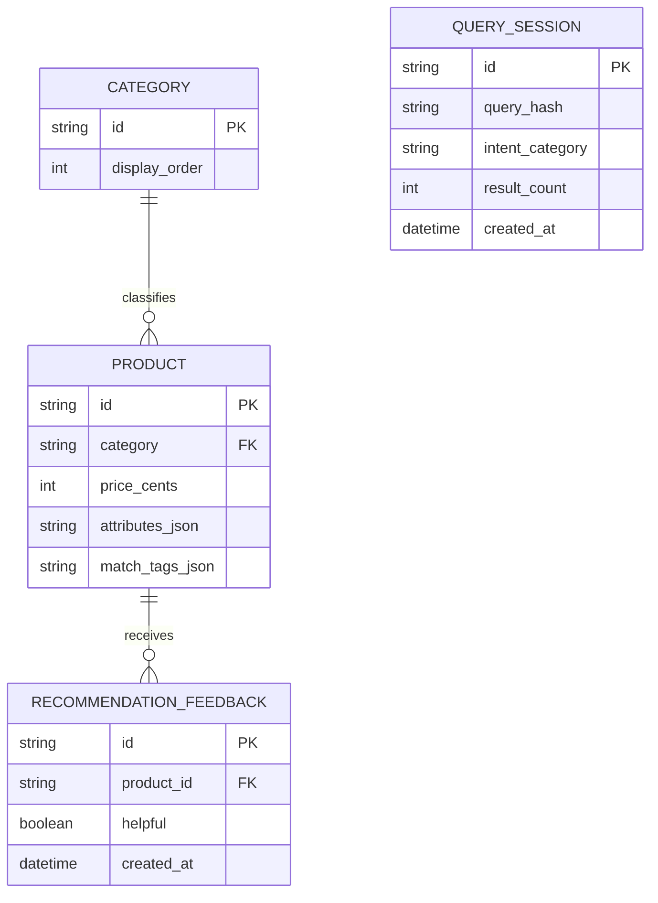

The API owns `categories`, `products`, `query_sessions`, and `recommendation_feedback`. Product and category seeds come from the public content model. New query-session fingerprints use HMAC-SHA-256 with a random process-local key; the raw query is not stored or logged, and fingerprints do not correlate across restarts. Existing databases created before that change may still contain legacy unkeyed hashes. Product prices use integer cents. SQLite constraints and parameterized repository statements protect local invariants. The initial seed is atomic, but the schema currently uses `CREATE TABLE IF NOT EXISTS` and has no versioned migration system. Because seed inserts ignore conflicts, replace the local SQLite file after changing seed product/category data. Tests use in-memory SQLite; the running API stores its file in `shopsense-backend/data/`.

## 7. API and internal contracts

The companion API contract is in [shopsense-backend](https://github.com/gopichand-retail-apps/shopsense-backend). It remains the authority for request/response shapes; the local typed/validated adapter is in the source map. Keep public paths, status/error envelopes, headers, payload validation, and compatibility tied to that source.

### API Contract

| Method | Route              | Request                     | Result                                      |
| ------ | ------------------ | --------------------------- | ------------------------------------------- |
| GET    | `/api/v1/health`   | None                        | Service and SQLite readiness                |
| GET    | `/api/v1/catalog`  | Optional validated category | Catalog rows and stored attributes          |
| POST   | `/api/v1/search`   | Bounded `{ query }`         | Ranked catalog products and matched details |
| POST   | `/api/v1/feedback` | `{ productId, helpful }`    | Persisted feedback acceptance               |

Success responses use `{ data }`; failures use `{ error: { code, message, requestId } }`. The complete request/response contract is in [`shopsense-backend/openapi.yaml`](https://github.com/gopichand-retail-apps/shopsense-backend/blob/main/openapi.yaml). `X-Request-ID` and `X-Trace-ID` are returned on responses; request IDs are included in structured logs. Request bodies and raw queries are not logged.

## 8. Security, privacy, and egress

Current release limitation: **Shopper/catalog-editor identity and authorization are not established. Remote Unsplash images, formatting, generated-type ordering, and dialog-focus work remain. IT image smoke failed; do not label all checks passing.**

### Authorization and API Ownership Matrix

The local API has no authenticated principals, shopper accounts, roles, or
catalog-editor capability. The allowlisted `Origin` check is a browser boundary,
not authentication or authorization. Loopback binding is the current exposure
limit.

| Route            | Current actor and authorization                                                             | Reads/writes                                                                                    | Expected failures and recovery                                                                                               |
| ---------------- | ------------------------------------------------------------------------------------------- | ----------------------------------------------------------------------------------------------- | ---------------------------------------------------------------------------------------------------------------------------- |
| `GET /health`    | Any local caller; no identity check. Health is excluded from rate limiting.                 | Reports API/SQLite readiness; no domain write.                                                  | Safe internal error; restart/check local database if unavailable.                                                            |
| `GET /catalog`   | Unauthenticated local browser or caller; optional category must exist in the public model.  | Reads catalog rows from API-owned SQLite.                                                       | `INVALID_CATEGORY`, `ORIGIN_NOT_ALLOWED`, or `RATE_LIMITED`; correct the filter or retry later.                              |
| `POST /search`   | Unauthenticated local browser or caller; strict JSON, bounded body, query length 3–240.     | Reads catalog; stores only a keyed fingerprint, inferred category, result count, and timestamp. | `INVALID_JSON`, `PAYLOAD_TOO_LARGE`, `INVALID_SEARCH`, `RATE_LIMITED`, or safe `INTERNAL_ERROR`; keep the query and retry.   |
| `POST /feedback` | Unauthenticated local browser or caller; strict product ID and boolean; product must exist. | Reads product, then inserts minimal feedback.                                                   | `INVALID_FEEDBACK`, `PRODUCT_NOT_FOUND`, `RATE_LIMITED`, or safe `INTERNAL_ERROR`; retry the feedback action if appropriate. |
| Other paths      | No route or elevated actor exists.                                                          | No domain read/write.                                                                           | Safe `NOT_FOUND` response.                                                                                                   |

`SHOPSENSE_ALLOWED_ORIGINS` may replace the model origin list. The process-local
rate limiter defaults to 120 requests per minute per remote address, excluding
health. It is not a distributed quota or identity control.

### Integrations, Modes, and Observability

| Integration or mode        | Current behavior                                                                                                                                                                            |
| -------------------------- | ------------------------------------------------------------------------------------------------------------------------------------------------------------------------------------------- |
| Product catalog            | Synthetic catalog seeded from the versioned public model into API-owned SQLite.                                                                                                             |
| Recommendation provider    | No external LLM/provider is called. Ranking is deterministic and local.                                                                                                                     |
| Identity and authorization | Not implemented. No user/account or editor role is accepted.                                                                                                                                |
| Mock mode                  | `NEXT_PUBLIC_IS_MOCK=true` selects the configured mock API origin. The local mock path still calls the same REST API and uses seeded synthetic data; it is not an in-browser fake response. |
| Live mode                  | `NEXT_PUBLIC_IS_MOCK=false` selects `SHOPSENSE_REAL_API_URL`. E2E uses the isolated local API as the selected endpoint; this does not prove a production/third-party integration.           |
| Telemetry                  | API emits JSON request/startup events with request/trace IDs, route template, method, status, duration, outcome, and safe error code. It omits request bodies and raw queries.              |

Keep private credentials out of public models, browser bundles, logs, URLs, and source archives. The existing remote Unsplash image dependency remains; no external LLM is connected. Keep logs limited to the source-defined request/trace and safe aggregate fields. Backups, retention, deletion, and real-user ownership need explicit product/operations decisions before external exposure.

## 9. Design, accessibility, and platform adapters

The existing product styling is authored in [src/app/globals.css](../src/app/globals.css), [src/app/styles/catalog.css](../src/app/styles/catalog.css), [src/app/styles/discovery.css](../src/app/styles/discovery.css), [src/app/styles/overlays.css](../src/app/styles/overlays.css), [src/app/styles/responsive.css](../src/app/styles/responsive.css), [src/app/styles/shell.css](../src/app/styles/shell.css). Preserve its tokens, layout density, fonts/assets, breakpoints, and component states. User-facing strings/locale rules follow the active validated model. WCAG 2.2 AA is a target, not a verified conformance claim: keyboard/focus/dialog behavior, zoom/reflow, contrast, reduced motion, and screen readers require their applicable checks. No redesign or new visual measurements were performed here. Native/mobile packaging and device adapters are **not implemented by this web repository**.

## 10. Build, checks, and deployment

Configured npm scripts, from this repository with Node **24.15.0**; use `npm.cmd` in PowerShell:

| Command                    | Actual manifest definition                                                                                                                     |
| -------------------------- | ---------------------------------------------------------------------------------------------------------------------------------------------- |
| `npm.cmd run dev`          | `next dev --hostname 127.0.0.1 --port 5801`                                                                                                    |
| `npm.cmd run build`        | `next build`                                                                                                                                   |
| `npm.cmd run start`        | `next start --hostname 127.0.0.1 --port 5801`                                                                                                  |
| `npm.cmd run lint`         | `eslint`                                                                                                                                       |
| `npm.cmd run format:check` | `prettier --check "src/**/*.{ts,tsx,css}" "scripts/**/*.mjs" "tests/**/*.{ts,tsx,mjs}" "e2e/**/*.ts" ".github/workflows/*.yml" "*.ts" "*.mjs"` |
| `npm.cmd run typecheck`    | `tsc --noEmit`                                                                                                                                 |
| `npm.cmd run test:unit`    | `vitest run`                                                                                                                                   |
| `npm.cmd run test:cov`     | `vitest run --coverage`                                                                                                                        |
| `npm.cmd run test:e2e`     | `node scripts/test-e2e.mjs`                                                                                                                    |

Install with `npm.cmd ci` and retain [package-lock.json](../package-lock.json). Registry access is required for a clean dependency installation. These commands describe the configured checks; execution results are listed in section 13.

Frontend address: http://127.0.0.1:5801. API health: http://127.0.0.1:5802/api/v1/health. Vercel uses [vercel.json](../vercel.json) and the documented keys in [.env.vercel.example](../.env.vercel.example). Native Next output/routing is retained. The environment example is not automatically loaded under that filename. Public endpoints and mode selectors are build inputs; rebuild/redeploy after changes. A hosted frontend still requires an independently verified API.

CI configuration is listed in section 3. Run the configured checks before merging or releasing. Deployment requires separate verification of the selected hosting environment.

## 11. Architecture decisions and tradeoffs

### Implemented Design Patterns and Invariants

- The application is a local modular monolith, not a set of independently
  deployed microservices. The frontend is a presentation/client-state boundary;
  the API is the only SQLite client.
- The backend request path is HTTP handler -> route/schema validation ->
  recommendation service -> repository. The ranker is a deterministic domain
  service; it has no external model dependency.
- One strict `version/appId/locale/messages/data` model feeds frontend copy and
  synthetic seed data. Both frontend and backend validate it at their trust
  boundary. The old public architecture model and UI route are removed.
- Catalog reads and writes use a repository boundary, parameterized SQL,
  foreign keys, constraints, and an atomic transaction for initial seed data.
  `INSERT OR IGNORE` preserves existing rows; it does not migrate changed seed
  content into an existing local database.
- Recommendation explanations are assembled only from matched stored
  attributes/tags or the stored category label. Sorting is deterministic and
  results are capped by the model.
- The browser owns only saved product IDs, appearance preference, active search,
  and compare selection. Saved IDs resolve against the latest catalog; compare
  selection is capped at two and is not persisted.
- New query records contain a keyed HMAC fingerprint, inferred category,
  result count, and timestamp. The key is random and process-local; raw queries
  and request bodies are not persisted or logged. A transaction writes the
  seed, but query and feedback events are independent inserts.
- API failures use a stable, model-backed error code/message/request-ID
  envelope. Unexpected internal details are not returned to the browser.

The two Git repositories remain separate. Each owns one maintained README and this repository-local architecture guide. Shared application behavior may be described here for contract context, but implementation changes belong to the owning source module.

## 12. Requirements traceability

| Capability                      | Acceptance                                                        | Owner/path                         | Current status                                                | Evidence                               | Risk                                                                                                                                                                                                                      |
| ------------------------------- | ----------------------------------------------------------------- | ---------------------------------- | ------------------------------------------------------------- | -------------------------------------- | ------------------------------------------------------------------------------------------------------------------------------------------------------------------------------------------------------------------------- |
| Repository-local architecture   | Guide available in this checkout and linked from README           | docs/architecture.md; README.md    | Documented and validated                                      | File, link, and diagram checks         | Keep documentation consistent with source changes                                                                                                                                                                         |
| UI composition and API boundary | Preserve existing workflows and failure states                    | src/app/layout.tsx and source map  | Implemented; application verification limits are listed below | Current source and existing app design | Shopper/catalog-editor identity and authorization are not established. Remote Unsplash images, formatting, generated-type ordering, and dialog-focus work remain. IT image smoke failed; do not label all checks passing. |
| Public deployment               | Verified identity, data durability, recovery, and hosted behavior | Existing deployment/API boundaries | Needs separate hardening/verification                         | No new hosted evidence                 | Local checks do not establish production readiness                                                                                                                                                                        |

## 13. Dated verification and limitations

Last documentation review: **2026-11-09**. The checks below distinguish documentation validation from application and deployment testing.

- Repository-local guide, README link, source-path references, section/contents anchors, and Mermaid syntax: passed documentation validation.
- New application tests/builds, coverage, dependency audits, browser/device accessibility/performance, hosted CI, and Vercel deployment: **not rerun for the documentation updates**.
- Frontend production builds passed on 2026-11-09 with Node 24.15.0. Build success does not establish that all application quality gates pass.
- Outstanding baseline limit: Shopper/catalog-editor identity and authorization are not established. Remote Unsplash images, formatting, generated-type ordering, and dialog-focus work remain. IT image smoke failed; do not label all checks passing.

The baseline results below record earlier validation. Re-run the listed commands against the current revision before release.

Previously recorded application verification:

### Verification and Known Gaps

Run the API from `shopsense-backend` and the UI from `shopsense-frontend` in
separate terminals. Use Node.js 22.13 or later.

```sh
cd shopsense-backend
npm ci
npm run dev
```

```sh
cd shopsense-frontend
npm ci
npm run dev
```

Backend checks: `npm run format:check`, `npm run lint`, `npm run check`,
`npm test`, `npm run test:cov`, and `npm audit`. Frontend checks:
`npm run format:check`, `npm run lint`, `npm run typecheck`, `npm run test:unit`,
`npm run test:cov`, `npm audit`, and both `npm run test:e2e` and
`NEXT_PUBLIC_IS_MOCK=false npm run test:e2e`. Unit/API tests use synthetic
fixtures and in-memory SQLite. Playwright builds into an ignored test directory,
uses ports 5881/5882, and starts an in-memory SQLite API; it does not reuse
services or databases on ports 5801/5802. Coverage gates require at least 90%
for statements, branches, functions, and lines.

Known gaps: no identity/role/record ownership, no catalog editor, no
versioned SQLite migration or seed-update workflow, no distributed rate limit,
no persistent HMAC key rotation, no TLS, and no real external provider. Keep
both local services loopback-only and use synthetic data until these controls
are implemented and verified.

## 14. Extension rules and companion repository

Start with [README.md](../README.md) and this guide. The companion repository is [shopsense-backend](https://github.com/gopichand-retail-apps/shopsense-backend); clone the pair as siblings when using the existing local integration/model contract. This guide is inside the current repository and does not depend on a parent-folder architecture file to exist.

Update this guide when owned source, routes, persistence, identity, UI states, egress, or deployment behavior changes. Coordinate public contract changes with the companion repository and tests. Preserve existing data, run isolated checks with synthetic records, record failures, and review release and infrastructure changes before publication.
